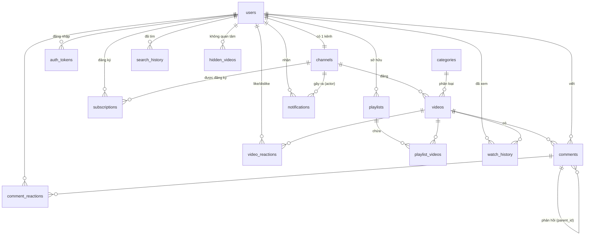

# Cơ sở dữ liệu (SQLite)

- **File**: `backend/vtube.db`, tự tạo khi chạy backend.
- **Cấu trúc bảng**: `backend/src/main/resources/schema.sql`. Chạy mỗi lần khởi động, dùng `IF NOT EXISTS` nên không mất dữ liệu.
- **Dữ liệu mẫu**: `backend/src/main/resources/seed.sql`. Chỉ nạp khi bảng `users` còn trống. Sinh bằng `python backend/tools/gen_seed.py`.
- **Làm lại từ đầu**: tắt backend, xóa `vtube.db`, chạy lại.
- **Xem dữ liệu**: mở `vtube.db` bằng [DB Browser for SQLite](https://sqlitebrowser.org/) hoặc Database tool của IntelliJ.

## Sơ đồ quan hệ

## Các bảng

| Bảng | Mục đích | Cột đáng chú ý |
| --- | --- | --- |
| `users` | Tài khoản | `email` duy nhất (không phân biệt hoa thường), `password_hash` (BCrypt), `history_paused` |
| `channels` | Kênh, mỗi user đúng 1 kênh | `handle` duy nhất, `verified`, `subscriber_count` (đếm sẵn) |
| `categories` | Danh mục cho chip Trang chủ | `slug`: music, gaming, news, education, food, travel, tech, entertainment, sports |
| `videos` | Video và Shorts | `is_short`, `is_live`, `visibility` (public, unlisted, private), các cột đếm `view/like/dislike/comment_count` |
| `video_reactions` | Like / dislike video | `value` = 1 hoặc -1; khóa chính (user_id, video_id) |
| `comments` | Bình luận | `parent_id` NULL = gốc; `reply_count`, `is_pinned`, `is_hearted` |
| `comment_reactions` | Like bình luận | như `video_reactions` |
| `subscriptions` | Đăng ký kênh | `notify_mode`: all, personalized, none |
| `playlists` | Danh sách phát | `kind`: liked (Video đã thích), watch_later (Xem sau), custom |
| `playlist_videos` | Video trong playlist | `position` (thứ tự kéo thả), `added_at` |
| `watch_history` | Lịch sử xem | `progress_seconds`, `watched_at`; mỗi video 1 dòng (xem lại thì cập nhật) |
| `search_history` | Từ khóa đã tìm | khóa chính (user_id, keyword) |
| `hidden_videos` | Video bấm "Không quan tâm" | ẩn khỏi feed Trang chủ |
| `notifications` | Thông báo | `type`, `actor_channel_id`, `video_id`, `comment_id`, `is_read` |
| `auth_tokens` | Token đăng nhập | hết hạn sau 30 ngày (`app.token-days`) |

**Quy ước:**
- Thời gian lưu dạng chuỗi ISO-8601 UTC: `2026-10-22T04:30:00Z`.
- Kiểu boolean lưu là `INTEGER` 0/1.
- Khóa ngoại bật `ON DELETE CASCADE`: xóa video thì bình luận, reaction, lịch sử của video đó cũng mất.

## Dữ liệu mẫu

| ID | Kênh (đăng nhập bằng) | Ghi chú |
| --- | --- | --- |
| 1 | Nguyễn Văn A, `demo@vtube.vn` | Tài khoản demo: đã đăng ký kênh 2–6, có lịch sử, playlist, thông báo |
| 2 | VTech Studio, `vtech@vtube.vn` | Có video 1 với bình luận ghim và phản hồi |
| 3 | Ẩm Thực Bụi, `amthucbui@vtube.vn` | Có video đang phát trực tiếp (#25) |
| 4 | Vietnam Vibes, `vietnamvibes@vtube.vn` | |
| 5 | Lập Trình Di Động, `laptrinhdd@vtube.vn` | Có playlist công khai "Học Flutter" (#100, của user 1) |
| 6 | Chill Melody, `chillmelody@vtube.vn` | |
| 7 | Góc Công Nghệ, `goccongnghe@vtube.vn` | |

- Mật khẩu của mọi tài khoản: `123456`.
- Video thường: id 1–25. Shorts: id 26–33.
- File video là video mẫu công khai của Google (Big Buck Bunny, Sintel...), nên nội dung không khớp tiêu đề. Đây là dữ liệu giả lập.
