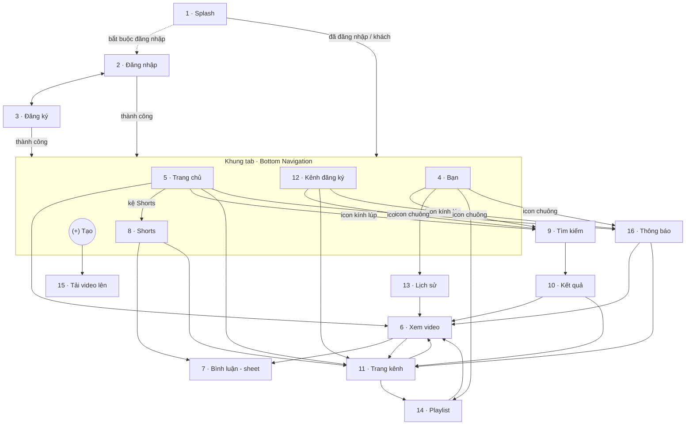
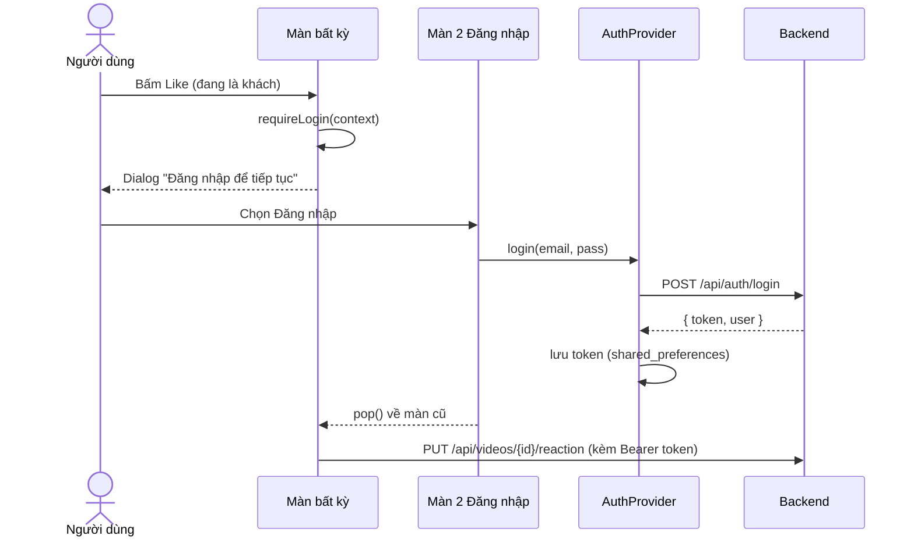
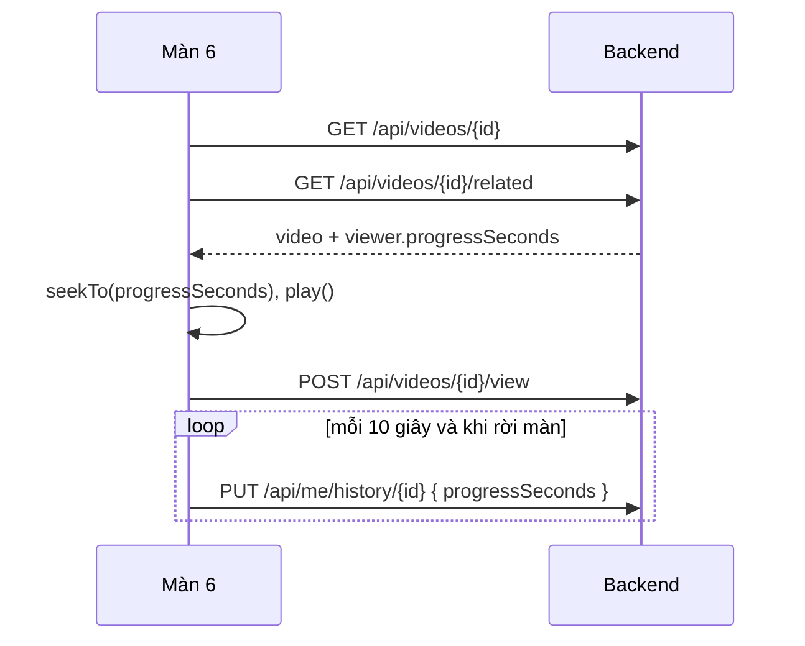
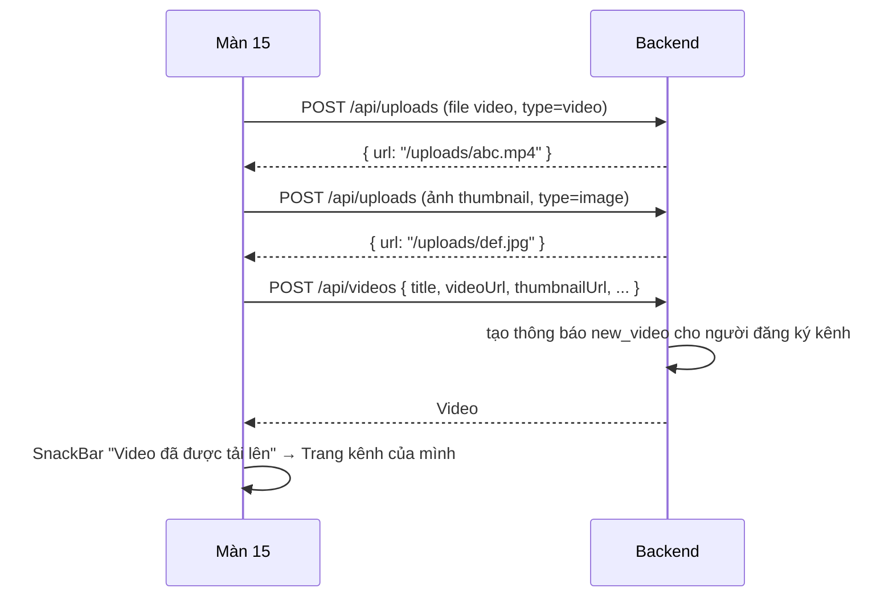

# Luồng điều hướng và nghiệp vụ

GitHub hiển thị trực tiếp các sơ đồ dưới đây. Bản có hình vẽ đẹp hơn nằm trong tài liệu đặc tả online.

## Điều hướng giữa 16 màn

| Màn | Route (`AppRoutes`) | Ghi chú |
| --- | --- | --- |
| 1 | `/splash` | Màn khởi động |
| 2 | `/login` | Mở bằng `context.push`, xong thì `pop` về màn trước |
| 3 | `/register` | |
| 5, 8, 12, 4 | `/home`, `/shorts`, `/subscriptions`, `/you` | 4 tab, giữ trạng thái khi đổi tab |
| 6 | `/video/:id` | |
| 7 | (không có route) | Bottom sheet: `showCommentsSheet(context, videoId)` |
| 8 | `/shorts?start=<id>` | Mở đúng short đã bấm |
| 9, 10 | `/search`, `/search/results?q=` | |
| 11 | `/channel/:id` | |
| 13 | `/history` | |
| 14 | `/playlist/:id` | |
| 15 | `/upload`, `/upload?short=1` | |
| 16 | `/notifications` | |

## Đăng nhập khi đang làm thao tác cần tài khoản

## Xem video và lưu tiến độ

## Tải video lên

## Thông báo được tạo khi nào

| Sự kiện | Ai nhận | `type` |
| --- | --- | --- |
| Đăng video công khai | Người đăng ký kênh (trừ `notify_mode = none`) | `new_video` / `new_short` |
| Trả lời bình luận | Người viết bình luận được trả lời | `comment_reply` |
| Chủ kênh thả tim bình luận | Người viết bình luận | `comment_heart` |
| Có người đăng ký kênh | Chủ kênh | `new_subscriber` |

Không ai nhận thông báo về hành động của chính mình.
